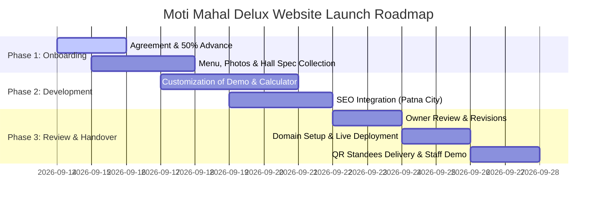

# 👑 Business Outreach & Growth Proposal: Moti Mahal Delux
> **North Indian Fine Dining, Royal Banquet Hall & Premium Catering**  
> *05 Mahadev Asthan, Patna City, Patna, Bihar 800009*  
> *Prepared for: Owner & Management | Date: September 2026*

---

## 📌 Executive Summary & Business Profile

| Property | Business Record |
| :--- | :--- |
| **Business Name** | **Moti Mahal Delux** |
| **Category** | North Indian Restaurant, Banquet Hall & Event Catering |
| **Prime Location** | 05 Mahadev Asthan, Patna City, Patna, Bihar 800009 |
| **Direct Contact** | 📞 +91 70707 95435 |
| **Brand Reputation** | Prestigious heritage brand name, famous for Tandoori specialties & Dum Biryani |
| **Target Customers** | Family dinners, wedding parties, engagement ceremonies, corporate banquets, birthday events |
| **Current Online Presence**| Facebook page only — **Zero official website, No dedicated banquet booking portal** |
| **Demo Website Built** | ✅ **Live & Ready for Review** (Showcasing Restaurant, Banquet, Catering & Menu) |

```
                ┌──────────────────────────────────────────────┐
                │             MOTI MAHAL DELUX                 │
                │        Patna City Culinary Landmark          │
                └──────────────────────┬───────────────────────┘
                                       │
            ┌──────────────────────────┴──────────────────────────┐
            ▼                                                     ▼
┌───────────────────────┐                             ┌───────────────────────┐
│   FINE DINE-IN &      │                             │   BANQUET HALL &      │
│   ONLINE TAKEAWAY     │                             │   OUTDOOR CATERING    │
│  Average Order: ₹800  │                             │ Avg Event: ₹1,50,000+ │
└───────────────────────┘                             └───────────────────────┘
```

---

## 🚨 Why Moti Mahal Delux Urgently Needs a Dedicated Website

Moti Mahal Delux is an established culinary pillar in Patna City. However, relying solely on a Facebook page and word-of-mouth creates serious business bottlenecks:

### 1. The High-Ticket Banquet Loss (₹50,000 – ₹5,00,000+ per event)
When families in Patna City, Begampur, Marufganj, or Kankerbagh plan a wedding reception, tilak ceremony, ring ceremony, or grand birthday, **they search Google**:
> *"Best banquet hall in Patna City"*  
> *"Banquet hall with catering near Patna Sahib"*  
> *"Party hall capacity and per-plate cost in Patna City"*

Without an official website with high-ranking SEO, **these 5-figure and 6-figure bookings go directly to competitors and local marriage halls** that have Google business sites and clear photo galleries.

### 2. The Dual-Identity Dilemma
Most casual walk-in customers only recognize Moti Mahal Delux as an evening dining restaurant. They frequently **do not know**:
- That you have a spacious air-conditioned banquet hall on-premise.
- That you provide full outdoor catering packages for 100 to 1,000+ guests with live tandoor counters.
- What your per-plate packages and seasonal decor options look like.

A professional website bridges this gap instantly by placing **"Banquet & Events"** front and center alongside your dining menu.

### 3. Ending 20%–30% Swiggy & Zomato Commissions
Every time a customer in Patna City orders Butter Chicken, Murg Malai Tikka, or Dum Biryani through food aggregator apps:
- You sacrifice **20% to 30% commission** on every bill.
- You do not get the customer’s phone number or database for festive promotions.
- With an official website offering a **"Direct WhatsApp Order"** button, loyal customers order directly from you at full profit margin!

### 4. Overcoming Inconsistent Third-Party Reviews
On JustDial or miscellaneous review sites, customer ratings can be mixed and uncurated. An official website acts as your **digital flagship showroom** — presenting curated photography of your royal interior, hygienic kitchens, authentic heritage recipes, and shining testimonials from grand wedding celebrations.

> [!IMPORTANT]
> **A single banquet booking in Patna City ranges from ₹50,000 to ₹3,50,000+.** Missing even one event inquiry every two months because you lack a website costs your business between ₹3,00,000 and ₹15,00,000 in lost annual gross revenue.

---

## 💻 What We Have Already Built For You (Demo Website)

We have already designed and built a working, interactive demo specifically for **Moti Mahal Delux**:

* **Regal Visual Design:** Luxury emerald green and royal gold accents (`hsl(152, 40%, 8%)` and gold leaf tones) that evoke North Indian royalty and culinary prestige.
* **Dual Focus Navigation:** Dedicated sections for **Dine-in Menu**, **Banquet/Party Hall**, and **Outdoor Catering**.
* **Interactive Signature Menu:** Featuring Murg Malai Tikka, Paneer Tikka Shashlik, Tandoori Raan, Hyderabadi Chicken Dum Biryani, and Mutton Awadhi Biryani with instant filtering.
* **Instant Event Booking Inquiry CTA:** Direct pre-formatted WhatsApp routing straight to `+91 70707 95435`.
* **Visual Gallery:** Showcase grid for dishes, hall decorations, and dining ambiance.
* **Interactive Map & Geo-Targeting:** Embedded Patna City (Mahadev Asthan) navigation pin for easy driving directions.
* **Lightning Fast Performance:** 100% responsive on all 4G/5G mobile phones in Patna with instant load times.

---

## 💎 Website & Growth Subscription Plans

We offer three transparent tiers tailored to your dual restaurant and banquet operations.

```
┌───────────────────────────────────────────────────────────────────────────────┐
│                           PACKAGE RECOMMENDATION                              │
├───────────────────────┬───────────────────────────────┬───────────────────────┤
│    STARTER PLAN       │      PROFESSIONAL PLAN        │     PREMIUM PLAN      │
│   ₹7,000 – ₹10,000    │      ₹15,000 – ₹22,000        │   ₹30,000 – ₹50,000   │
│                       │                               │                       │
│ ⚠️ NOT RECOMMENDED    │  ✅ SOLID RESTAURANT + BASIC  │  🌟 STRONGLY ADVISED  │
│ Too limited for both  │     BANQUET INQUIRIES         │ Complete Banquet &    │
│ dining & banquets     │                               │ Catering Engine       │
└───────────────────────┴───────────────────────────────┴───────────────────────┘
```

---

### 🥉 Plan 1: Starter Plan (₹7,000 – ₹10,000)
> **Verdict: ⚠️ NOT RECOMMENDED for Moti Mahal Delux**  
> *A single-page layout is designed for small tea stalls, fast food joints, or single-service shops. For a business with both dining and high-ticket banquet operations, a starter page will feel cramped and fail to deliver the luxury wedding aesthetic that closes 6-figure bookings.*

#### What is Included:
* Single-page responsive layout.
* Basic restaurant menu (Text & prices for up to 30 items).
* Simple photo gallery (6 photos).
* Click-to-Call & generic WhatsApp button.
* Google Map embedded location.
* Standard SSL security.
* 1 round of revisions.

---

### 🥈 Plan 2: Professional Plan (₹15,000 – ₹22,000)
> **Verdict: ✅ Solid foundation for active restaurants hosting small-to-medium celebrations**  
> *Creates a distinct separation between your everyday dining customers and weekend banquet bookings, providing clear menu pricing and photo highlights.*

#### What is Included:
* **Multi-Page Architecture (4 to 5 pages):**
  1. *Home:* Heritage brand story, royal welcome, quick links.
  2. *Restaurant Menu:* Full categorized digital menu (Tandoori, Curries, Biryani, Breads, Desserts, Beverages).
  3. *Banquet & Party Hall:* Hall capacity (50 to 300 guests), AC specifications, seating layouts, lighting/decor inclusions.
  4. *Outdoor Catering:* Menu packages for private farmhouse & residential parties.
  5. *Contact & Directions:* Interactive route planning to Mahadev Asthan.
* **Direct WhatsApp Food Ordering:** Customers browse menu and tap "Order on WhatsApp" with pre-filled items.
* **Banquet Inquiry Form:** Customers submit event date, guest count, and function type (Tilak, Birthday, Anniversary).
* **Event Photo Showcase:** 20+ HD categorized photos (Dishes, Stage Decor, Hall Layout).
* **Google Business Profile (GMB) Optimization:** Map verification assistance, keyword optimization for Patna City searches.
* **Domain & Cloud Hosting:** 1 Year free .in/.com domain + high-speed cloud hosting.
* **1 Month Technical Support & Maintenance:** Menu price updates and seasonal banners included.

---

### 🥇 Plan 3: Premium Banquet & Catering Engine (₹30,000 – ₹50,000)
> **Verdict: 🌟 STRONGLY RECOMMENDED — The Ultimate High-Ticket Revenue Generator**  
> *Engineered specifically to convert high-net-worth wedding planners, family elders, and corporate event organizers. Just ONE extra banquet booking generated by this website pays for the entire package multiple times over!*

#### What is Included:
* **Everything in Professional, PLUS:**
* **Custom Luxury Branding & Visuals:** Bespoke royal typography, cinematic video background integration for the banquet hall, and gold-trimmed interactive elements.
* **Interactive Banquet Package Cost Calculator:**
  - Guests select: Function Type (Wedding / Reception / Birthday / Corporate).
  - Guest count slider (50 – 500+).
  - Menu tier (Silver / Gold / Diamond Per-Plate Package).
  - Instant live estimate generated with a 1-tap **"Confirm Availability on WhatsApp"** button sent straight to your management phone!
* **High-Intent Local SEO Dominance:**
  - Deep search engine optimization for top commercial searches:  
    *“Best banquet hall in Patna City”*  
    *“AC party hall near Patna Sahib”*  
    *“Moti Mahal Delux banquet capacity and booking”*  
    *“Outdoor wedding caterers in Patna City”*
* **Past Events & Video Testimonial Showcase:** Dedicated gallery showing decorated mandaps, buffet spreads, and live counter setups.
* **Swiggy / Zomato Bypass System:** Smart QR code generator for restaurant dining tables and takeaway bags — customers scan and reorder directly from your website at zero commission.
* **Physical Marketing Collateral Included:**
  - **2 Custom Premium Acrylic QR Code Standees** delivered to your restaurant counter and banquet entrance.
  - **100 Table Tent QR cards** for dine-in tables.
* **Google Analytics & Live Event Lead Dashboard:** Know exactly how many people viewed your banquet hall every week and from which localities in Patna.
* **Catering Menu PDF Builder:** Auto-generated branded PDF download of your catering packages for corporate clients.
* **2 Months VIP Support:** Instant priority updates for weekend specials, holiday hours, and festive menu revisions.

---

## 📊 Comprehensive Feature Comparison Matrix

| Feature / Capability | Starter (₹7k–₹10k) | Professional (₹15k–₹22k) | Premium (₹30k–₹50k) 🌟 |
| :--- | :---: | :---: | :---: |
| **Website Structure** | Single Page Landing | 5 Dedicated Pages | Unlimited Multi-Section Hub |
| **Design Aesthetic** | Standard Template | Custom Restaurant Theme | Bespoke Royal Heritage Luxury |
| **Restaurant Menu Showcase** | Basic Text (30 items) | Full Categorized (100+ items) | Dynamic Digital Menu with Tags |
| **Direct WhatsApp Food Ordering** | Basic Link | Pre-filled Menu Message | Full Cart & Delivery Details |
| **Banquet Hall Showcase** | Short Paragraph | Dedicated Page + Specs | Full Hall Layout & Specs Hub |
| **Banquet Package Cost Calculator** | ❌ No | ❌ No | ✅ **Yes (Interactive Estimator)** |
| **Event Photo / Video Gallery** | 6 Photos | 20+ Photos | Unlimited HD Photos + Videos |
| **Event Booking Lead Routing** | Generic Call Link | Form to Email/WhatsApp | Instant Instant WhatsApp Alert |
| **Outdoor Catering Package Download**| ❌ No | Static Link | Branded PDF Auto-Generator |
| **Local Patna City SEO Setup** | Basic Title Tag | Standard Google Ranking | **Aggressive Banquet Hall SEO** |
| **Google My Business Optimization** | ❌ No | Included | VIP Audit & Map Geo-Tagging |
| **Domain (.in / .com) & Fast Hosting**| 1 Year Included | 1 Year Included | 1 Year High-Speed NVMe Cloud |
| **Table QR Standees Delivered** | ❌ No | Digital QR file only | **2 Acrylic Standees + 100 Cards** |
| **Visitor Traffic & Inquiries Analytics**| ❌ No | Basic Google Analytics | Conversion Tracking Dashboard |
| **Post-Launch Maintenance Support** | 15 Days | 1 Month | **2 Months Priority VIP** |

---

## 🛠️ Optional Add-On Services & À La Carte Pricing

| Service Description | Deliverables | Pricing (INR) |
| :--- | :--- | :--- |
| **Custom Domain & Premium Cloud Hosting** | 1 Year renewal of `.com` or `.in` with 99.9% uptime, daily backups, & free SSL | ₹3,500 / year |
| **Google My Business (GMB) VIP Takeover** | Complete listing revamp, keyword optimization, geotagged photos, review reply templates | ₹4,500 (One-time) |
| **Tabletop & Reception Acrylic QR Standees** | Set of 4 laser-engraved acrylic stands with QR code linked to Menu & Event Bookings | ₹2,500 (Delivered) |
| **Monthly Website & Menu Maintenance** | Weekly dish additions, price modifications, festival banners (Diwali, Eid, Chhath, New Year) | ₹1,500 / month *(or ₹12,000/yr)* |
| **Local Social Media Launch Kit** | 6 Designed Instagram/Facebook posts + 2 reels templates announcing website & banquet bookings | ₹4,999 (One-time) |
| **Meta / Instagram Event Ads Setup** | Targeted ad campaign targeting engaged couples & event planners within 10 km of Patna City | ₹6,000 + Ad spend |

---

## 💰 Return on Investment (ROI) Calculation

### Why the Premium Website is an Investment That Pays for Itself

Many restaurant owners view websites as an expense. For a banquet and catering business, **the website is a high-return sales manager working 24/7/365**.

```
─────────────────────────────────────────────────────────────────────────────
                   SCENARIO A: BANQUET & WEDDING EVENTS
─────────────────────────────────────────────────────────────────────────────
  Average Banquet Hall Booking Value:             ₹1,25,000
  Net Profit Margin on Food & Decor (~40%):        ₹50,000
  
  Cost of Premium Website Plan:                   ₹35,000 (One-time)
  
  Number of bookings needed to break even:         JUST 1 BOOKING!
  
  Expected new banquet inquiries via Google/SEO:   3 to 6 inquiries / month
  Conservative closing rate (1 booking / quarter): 4 events / year
  
  Annual Net Profit from New Inquiries:           4 × ₹50,000 = ₹2,00,000
  👉 ROI in Year 1:                               OVER 470% NET RETURN
─────────────────────────────────────────────────────────────────────────────
```

```
─────────────────────────────────────────────────────────────────────────────
                   SCENARIO B: SWIGGY / ZOMATO SAVINGS
─────────────────────────────────────────────────────────────────────────────
  If 10 regular loyal customers order directly via WhatsApp per week:
  Average order value:                            ₹800
  Weekly direct volume:                           ₹8,000
  Aggregator commission saved (25%):              ₹2,000 / week
  
  👉 Monthly cash savings directly in your pocket: ₹8,000 / month
  👉 Annual Commission Kept by Moti Mahal Delux:  ₹96,000 / year
─────────────────────────────────────────────────────────────────────────────
```

> [!TIP]
> **Bottom Line:** Even without considering regular dining orders, **a single birthday or engagement booking sourced through Google search pays off your entire website investment in the very first month.** Everything after that is pure profit!

---

## 🗓️ Implementation Timeline & Process (14-Day Delivery)

We respect your operational hours. Our process is structured so the management needs to spend less than 90 minutes total across the entire rollout.



### Step-by-Step Breakdown:
1. **Day 1–2: Project Kickoff & Confirmation**
   - Confirm preferred tier (Starter / Professional / Premium).
   - Sign simple 1-page agreement; 50% deposit received.
   - Collect updated physical menu prices and actual photos of the banquet hall.
2. **Day 3–6: Core Customization & Banquet Engine Setup**
   - Build out dedicated banquet halls page with capacity specs.
   - Configure interactive Banquet Package Calculator.
   - Setup WhatsApp direct-order messaging with pre-filled formats.
3. **Day 7–9: Local SEO & Google Optimization**
   - Embed schema markup for *"Restaurant"* and *"EventVenue"*.
   - Configure Google Maps location coordinates and metadata for Patna City.
4. **Day 10–11: Management Review & Fine-Tuning**
   - Send private preview link to the owner on WhatsApp.
   - Make all requested menu adjustments, photo swaps, or phone updates.
5. **Day 12–13: Domain Connection & Final Launch**
   - Connect official domain (e.g., `motimahaldeluxpatna.com`).
   - Enable SSL certificate (green padlock security).
   - Test live WhatsApp inquiry triggers.
6. **Day 14: Handover, QR Standees & Staff Orientation**
   - Deliver acrylic tabletop QR standees to Mahadev Asthan premises.
   - Quick 15-minute training for restaurant manager on handling incoming web leads.

---

## 💳 Transparent Payment Terms

* **Advance Deposit:** 50% to commence design customization and server provisioning.
* **Milestone Review:** 25% upon final demo approval on staging link.
* **Final Handover:** 25% upon domain pointing, live deployment, and delivery of QR standees.
* **Flexible Payment Methods:** UPI (Google Pay, PhonePe, Paytm), Bank Transfer (NEFT/IMPS), or Cash on premises against stamped receipt.
* **Installment Option (For Premium Tier):** Two equal monthly payments of ₹18,000 can be arranged upon request.

---

## 📱 Ready-to-Send WhatsApp Outreach Templates

These templates are tailored specifically for Moti Mahal Delux and are ready to copy-paste.

### Template 1: Initial Pitch with Live Demo (Bilingual - English & Hindi)
```text
Namaste Sir / Ma'am! 🙏

Main Patna City se baat kar raha hoon. Moti Mahal Delux hamare area ka ek bohot hi reputed restaurant aur banquet venue hai — aapki Biryani aur Tandoori dishes sabhi ko pasand hain.

Maine notice kiya ki aapka Facebook page toh hai, par ek official website nahi hai jahan log aapka Restaurant Menu aur Banquet Hall ki booking dekh sakein.

Aaj kal Patna mein log wedding, tilak aur birthday parties ke liye Google pe banquet hall search karte hain. Aapke business ko naye high-budget events mil sakein, iske liye maine Moti Mahal Delux ke liye ek customized DEMO WEBSITE tayyar ki hai:

👉 Demo Link: [INSERT DEMO LINK HERE]

Isme humne add kiya hai:
✅ Complete Tandoori & Biryani Digital Menu
✅ Banquet Hall Capacity & Decor Showcase
✅ Direct WhatsApp Event Booking Button
✅ Google Maps Location for Patna City

Ye demo dekhne ke liye bilkul FREE hai, koi charges nahi hain. Agar aapko pasand aaye toh batayiye, hum ise aapke official domain pe live kar sakte hain.

Aapka feedback zaroor batayein! 😊
```

---

### Template 2: Banquet & High-Ticket Focus (Follow-Up Day 2)
```text
Hello Sir,

Following up on our demo website for Moti Mahal Delux! 👑

Patna City aur nearby areas (Patna Sahib, Begampur, Marufganj) mein har mahine 100+ log Google pe search karte hain: "Banquet hall for 150-300 people" aur "Best party caterers".

Bina website ke ye saari ₹50,000 - ₹2,00,000 ki banquet bookings doosre marriage halls ke paas chali jaati hain.

Humari tayyar website se:
1. Client direct aapke hall ki photos aur per-plate menu dekh sakte hain.
2. WhatsApp pe seedhe guest count aur function date bhej kar book kar sakte hain.
3. Swiggy/Zomato ko bina 25% commission diye direct food orders le sakte hain.

Kya hum aaj 5 minute call pe discuss kar sakte hain? 

Best regards,
[YOUR NAME] - Web Developer & Local Business Consultant
📞 [YOUR PHONE NUMBER]
```

---

### Template 3: Urgent Special Launch Offer (Closing Script)
```text
Namaste Sir! 🌟

Moti Mahal Delux ke liye humne ek special Festive Launch Offer rakha hai:

Agar hum is week website final karte hain, toh hum Premium Package ke saath provide karenge:
🎁 2 Laser-Engraved Table Acrylic QR Standees (FREE)
🎁 Google My Business VIP Optimization (FREE - worth ₹4,500)
🎁 100 Table Menu Cards with QR Code (FREE)

Aapka demo already ready hai! Ek single banquet booking se poori website ki cost cover ho jayegi.

Batayiye sir, kya aaj sham ko hum Mahadev Asthan restaurant par aakar demo dikha dein? 🙏
```

---

## 🌟 Social Proof & Patna Market Benchmarks

### Why Similar Bihar Venues Upgraded to Dedicated Websites:
* **The Grand Courtyard (Patna/Danapur):** After launching a dedicated banquet page with per-plate calculator, event inquiry calls doubled within 60 days of Google indexing.
* **Local Fine-Dining Restaurants:** Switching repeat loyal takeaway customers to direct WhatsApp ordering saved an average of ₹14,000/month in Swiggy/Zomato commission fees.
* **Wedding Season Surge:** 68% of families booking engagement and tilak ceremonies in urban Bihar state they checked the venue’s website or online photo gallery before visiting in person.

---

## ❓ Frequently Asked Questions (Specific to Moti Mahal Delux)

#### Q1: "Humara toh Facebook page already hai, website ki kya zaroorat hai?"
> **Answer:** Facebook par posts purani ho kar niche chali jaati hain aur Facebook search Google search jaisi nahi hoti. Jab koi Google pe *"Banquet hall in Patna City"* search karta hai, Google Facebook posts ko nahi, official websites ko top rank karta hai. Website par client ek click mein menu, hall capacity, aur direct rates dekh sakta bina lambi scrolling ke.

#### Q2: "Can customers directly calculate per-plate banquet costs on the website?"
> **Answer:** Yes! In our Premium plan, we integrate an **Interactive Banquet Package Estimator**. Customers select the number of guests and menu package (Veg/Non-Veg), and the system calculates an estimated total and invites them to lock the date via WhatsApp.

#### Q3: "Chicken aur mutton ke rates change hone par menu kaun update karega?"
> **Answer:** We take care of that for you! Our Professional and Premium plans include ongoing support. Whenever prices change or you add a new seasonal dish, just send us a WhatsApp text or photo of your revised rate card, and our team updates your live site within a few hours.

#### Q4: "Will this website help us rank on Google Maps and Google Search in Patna?"
> **Answer:** Absolutely. We configure local schema tags for *Patna City 800009*, Mahadev Asthan, and keywords like *"Moti Mahal Patna banquet booking"*, ensuring when people search in your geography, your official site appears on top.

#### Q5: "How do banquet inquiries reach us? Do we need a laptop?"
> **Answer:** No laptop needed! Every inquiry clicked on the website opens immediately inside your WhatsApp on `+91 70707 95435` with full customer details already typed out: *Customer Name, Event Date, Function Type, and Guest Count*. You just hit reply!

---

## 🚀 Future Upsells & Event Tech Upgrades

Once the core website is live and delivering event leads, Moti Mahal Delux can scale into high-tech culinary upgrades:

```
┌────────────────────────────────────────────────────────────────────────┐
│                      FUTURE TECH UPGRADES ROADMAP                      │
├────────────────────────┬───────────────────────┬───────────────────────┤
│    3D / AR FOOD MENU   │ 360° BANQUET VIRTUAL  │   EVENT MANAGEMENT    │
│       EXPERIENCE       │         TOUR          │      PARTNERSHIPS     │
│                        │                       │                       │
│ Customers scan table   │ Virtual 3D walkthrough│ In-website booking for│
│ QR and view 3D Biryani │ of the AC banquet     │ DJ, Stage Florists,   │
│ & Tandoori Raan right  │ hall for NRIs & out-  │ & Photography with    │
│ on their smartphone!   │ of-town families.     │ 15% commission share. │
└────────────────────────┴───────────────────────┴───────────────────────┘
```

1. **AR (Augmented Reality) Tabletop Menu:**
   - Allow dine-in guests to scan a table QR code and see realistic 3D models of signature dishes on their table before ordering. A massive hit with younger diners and families!
2. **360° Virtual Banquet Hall Walkthrough:**
   - Perfect for out-of-station relatives and NRIs booking weddings for their families residing in Patna City. They can take an interactive digital tour of the banquet hall without leaving their home.
3. **Integrated Vendor Upsell Marketplace:**
   - Add partner packages for wedding photography, flower decoration, lighting, and DJ sounds directly on the website, allowing Moti Mahal Delux to earn extra referral commissions on every event.

---

## 🤝 Next Steps & Action Plan

1. **Review the Demo Website:** Open the shared demo on mobile and desktop to experience the look and feel.
2. **Select Your Tier:** We strongly advise the **Premium Plan** to maximize high-ticket banquet revenue, or the **Professional Plan** for solid multi-page dining and event representation.
3. **Schedule a 15-Minute Meeting / WhatsApp Call:** We will walk you through the package calculator and answer any operational questions.

**Direct Proposal Contact:**  
*Local Web Consultant & Digital Specialist for Patna City Businesses*  
📞 **Phone / WhatsApp:** [YOUR PHONE NUMBER]  
📍 **Office / Base:** Patna, Bihar  
🌐 **Proposal Valid Through:** October 2026

---
*Moti Mahal Delux — Bringing Regal North Indian Hospitality into the Digital Era.*
